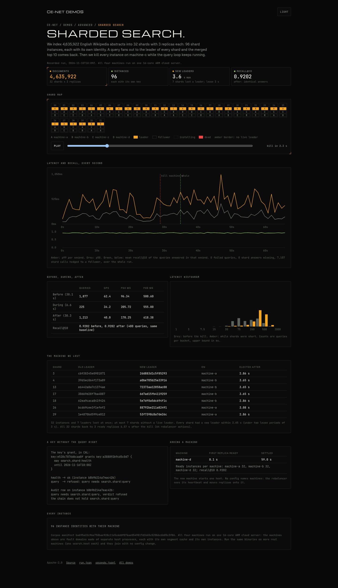

# Sharded search: one leader per shard, rebalanced live

We index 4,635,922 English Wikipedia abstracts into 32 shards with 3 replicas each: 96 shard instances, each with its
own Ed25519 key. A query fans out to the leader of every shard and the merged top 10 comes back. Then we kill every
instance on one machine while the query loop keeps running. Each shard that lost its leader elects a new one within one
lease period, the rebalancer brings every shard back to 3 replicas, and recall@10 comes out the same as before.



Page: [index.html](index.html) replays the recorded run from [proof/](proof/). Served by `search-dashboard`, the same
page shows the live state instead ([proof/live-dashboard.png](proof/live-dashboard.png)).

## What the recorded run measured

Recorded 2026-11-15 ([proof/run.json](proof/run.json), per second in [proof/seconds.jsonl](proof/seconds.jsonl), the
shard map every 500 ms in [proof/frames.json](proof/frames.json)). `kill-test` produced every number below.

| | |
|---|---|
| Corpus | BEIR DBpedia-Entity, 4,635,922 English Wikipedia abstracts; manifest `ba695a22c96e758bae928c11e5c6ddf076ae0549817d1b65c520bbcbb05c3f86` ([proof/manifest.json](proof/manifest.json)) |
| Layout | 32 shards x 3 replicas = 96 instances on machine-a, -b, -c (32 each), 1.36 GB of segments |
| Boot | all 96 ready, one leader per shard, 3.5 s after the hosts started (segments already in each machine's cache) |
| Lost | machine-c: 32 instances and 7 leaders at once (SIGKILL to its host's process group) |
| New leaders | all 7 within 2.86 to 3.65 s, median 3.08 s; lease 3 s, so under 2 lease periods |
| Back to 3 replicas | all 32 shards 6.57 s after the kill (64 rebalancer actions: 32 drops, 32 spawns) |
| Latency, before (30.1 s) | 62.4 queries/s, p50 96.3 ms, p99 500.6 ms |
| Latency, during (6.6 s) | 34.2 queries/s, p50 205.7 ms, p99 555.0 ms |
| Latency, after (30.3 s) | 40.0 queries/s, p50 170.3 ms, p99 618.4 ms |
| Failed queries | 0; 0 shard answers missing; 7,107 shard calls hedged to a follower |
| Recall@10 | 0.9202 before and 0.9202 after (400 test queries, same baseline); the answer hash is identical too |
| Refused | a key that holds only `search.shard:health` gets health, and its query is refused with an audit row (below) |
| Added machine-d | first replica ready 8.1 s after its host started, settled at 32/32/32 after 59.0 s, no config change, recall 0.9202 |

Read the latency with this in mind: the run shared one 16-core ARM server with other work at a load average of 40 to
55, so the absolute numbers are noisy, and "after" is slower than "before" because that load rose. What the run shows
is that no query failed and no shard answer was missing while a third of the fleet disappeared.

The refusal, as `proof/run.json` records it (`cap_test`):

```
key:e520c7076d6caa8f grants key:a388092b9cd5c0d7 {
  may search.shard:health
  until 2026-11-16T18:08Z
}
health -> ok (instance b8b9b214a7eac42b)
query  -> refused: query needs search.shard:query
audit row on b8b9b214a7eac42b: op query, need search.shard:query, verdict refused
```

## What is honest about "many nodes"

Only a few real machines exist. "Many nodes" here means many cell instances, each with its own key and its own
process. In the recorded run, all four "machines" were separate host processes on **one** physical server, each with
its own segment cache directory and its own instances. Killing a "machine" kills its host and every instance it
started, at once. That tests the software's reaction to losing a fault domain. It does not test a real network
partition.

The same binaries run with more real machines: start one `search-host` per machine, pointed at the same store. The
rebalancer learns machines only from host heartbeats, so a new machine gets shards with no change to any config. The
add-machine step of the run shows exactly that, with machine-d as a fourth host process.

Other things that differ from the plan, said plainly:

- **Corpus size.** Wikimedia no longer publishes the English abstract dump (about 6 M abstracts). We use BEIR
  DBpedia-Entity, which is 4.6 M English Wikipedia abstracts, with its 400 test queries.
- **Recall is 0.92, not 1.0.** Each shard ranks with its own BM25 statistics, which is how most sharded engines rank
  by default. The baseline is exact BM25 with global statistics, computed by scoring every one of the 4.6 M documents
  for every query (no index). The claim is that recall does not change when a machine is lost, not that it is 1.0.
- **Not yet on the ce-net mesh.** This repo builds from public crates only, so it carries small public stand-ins for the
  ce-net pieces it was designed around. None of those ce-net crates is public yet:

  | Designed for | In this repo | Status |
  |---|---|---|
  | ce-replica lease (leases with acks, majority leader) | `sharded-core::lease`, the same rule applied per shard, with tests | ported; ce-replica itself is not a dependency |
  | state.store | `dev-store`: Get, Put with `if_version`, List, change feed | the run used the dev store, not a node's state.store; no state.store adapter yet |
  | ce-search fan-out and merge | `search-router`: fan-out, merge, hedge at p95 | own code, not the ce-search crate |
  | ce-db-rs collections | one JSON-lines collection per shard, keyed by doc hash | not ce-db-rs |
  | ce-db-ts live subscription | `search-dashboard` follows the store's change feed and pushes Server-Sent Events | not ce-db-ts |
  | cap v3 + CAL, ce-gate | `cellnet::cap`: Ed25519 chains that only narrow, checked per op; refusals printed in CAL | a stand-in, not ce-cap v3 |
  | cell.build / artifact.index placement | `search-host` spawns instances on its machine | the manifest hash is in `proof/`, not published to artifact.index |

  A second real machine was not used in this run either: placing the host there needs the typed install path
  (cell.install building this repo from GitHub), which we have not done yet.

## Run it yourself (public dependencies only)

You need Rust (stable), `curl`, `unzip` and about 6 GB of free disk.

```sh
git clone https://github.com/ce-net/demo-sharded-search && cd demo-sharded-search
scripts/replay-kill-test.sh                 # 500,000 documents, 32 x 3 instances
LIMIT=all scripts/replay-kill-test.sh       # the whole corpus, the recorded run (baseline about 4 min)
```

The script downloads the corpus (640 MB, once), builds, loads, builds the exact baseline, and runs `kill-test`.
Measured on the same server: the 500,000-document replay took 165 s after the download and the build (96 instances
whole in 4.0 s with segments copied between machines, new leaders within 3.64 s, all shards whole 4.26 s after the
kill, recall@10 0.8910 before and after). A first `cargo build --release` takes a few minutes more. While
it runs, open http://127.0.0.1:7930/ for the live map. The result lands in `proof-local/run.json`. Open `index.html`
next to it (any static server) to replay it. By default only the first machine's cache holds the segments, so the
other machines copy them from a ready replica (`install_snapshot`); `SEED=all` pre-fills every cache.

CI ([.github/workflows/ci.yml](.github/workflows/ci.yml)) runs the unit tests and `scripts/ci-smoke.sh`, which is the
whole kill test on a synthetic corpus of 20,000 documents (4 shards x 3 replicas, lose one machine, add one) and checks
the recorded numbers.

## How it works

```
search-eval / kill-test ──query──> search.router ──fan-out to each shard's leader──> search.shard x 96
                                        │   hedge to a follower after the p95 delay       │ each writes its own record
                                        └── follows ss/s/* in the store <─────────────────┘ every 500 ms (beat, vote)
search.rebalancer ──reads leases + host heartbeats──> plan ──spawn/stop──> search.host (one per machine)
search.dashboard ──follows the change feed──> browser (SSE)
```

| Cell | Crate | Ops (right needed) |
|---|---|---|
| `search.shard` | `crates/search-shard` | `health`, `query`, `ingest` (leader only, forwarded to followers), `snapshot`, `install_snapshot` (`search.shard:<op>`) |
| `search.router` | `crates/search-router` | `health`, `query` |
| `search.rebalancer` | `crates/search-rebalancer` | `status` |
| `search.host` | `crates/search-host` | `health`, `spawn`, `instances`, `stop`, `kill_all` |
| `state.store` (dev) | `crates/dev-store` | `get`, `put`, `list`, `changes`, `health` |
| eval | `crates/search-eval` | `baseline`, `recall`, `load` |

- **Leases** (`crates/sharded-core/src/lease.rs`). Each instance writes only its own record: a beat counter, its vote
  and the beat it acks. Liveness is "the beat changed within the lease" on the reader's own clock, so no two clocks
  are compared. The candidate is the first live, ready member in placement order. It leads only while a majority of
  the shard's members vote for it with a beat it emitted less than one lease ago. A voter moves its vote only after
  the old leader's beat stood still for a full lease, so two leaders never overlap. Without a majority, nobody leads,
  and reads still go to any ready replica.
- **Segments** (`segment.rs`). One immutable file per shard, named by its sha256 and read through mmap. Replicas on
  the same machine share one copy in the page cache. A new replica installs from its machine's cache, or copies the
  file from a ready replica and checks the hash.
- **Placement** (`plan.rs`). Drop members whose beat stood still for a lease. Refill each shard on the machine with
  the fewest copies of that shard, then the fewest instances. When everything is whole but machines are uneven, move
  one replica at a time: spawn on the light machine, then retire the extra copy.
- **Caps** (`crates/cellnet/src/cap.rs`). Every cell gets a chain from the run's root key, and a host narrows its own
  chain for each instance it spawns. Each connection proves that it holds the key. Each op checks its right, and
  every refusal is written to the audit log with the presented grant printed in CAL.

## Repo

`crates/sharded-core` (pure: tokenizer, segments, lease, planner, stats), `crates/cellnet` (identities, caps, typed
calls over TCP, the store client), `crates/search-api` (the typed contracts and store records), one crate per cell,
`crates/corpus-loader`, `crates/kill-test`, `index.html` + `web/` (the page), `proof/` (the recorded run).

Apache-2.0. Author: Leif Rydenfalk.
